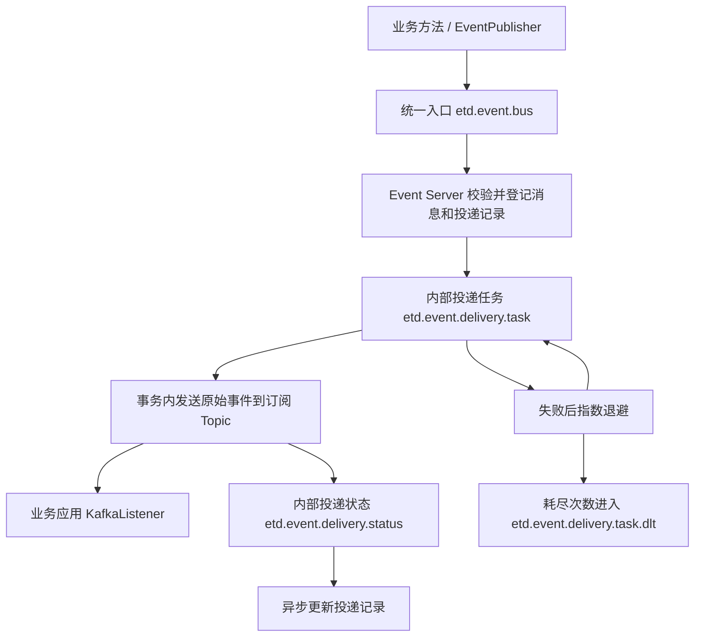

# ETD Event Bus

基于 Kafka 的事件总线，面向 Java 21、Spring Boot 3.5.x、Spring Cloud 2025.x。业务应用发布统一事件，Event Server 校验事件类型、登记原始消息并按订阅生成投递任务，随后将原始事件分发到各业务 Topic。

本文以当前源码为准，接入示例参考 `etd-business-event` 和 `etd-business-upms`。

## 1. 模块与能力

| 模块 | 职责 |
| --- | --- |
| `etd-framework-event-core` | 定义 `EventMessage`、JSON 编解码器、事件 ID 生成接口及底层发送接口，不包含 Kafka 监听器 |
| `etd-framework-starter-event-client` | 雪花事件 ID、统一消息构建、异步发布、`@Event` 注解、SpEL、请求上下文传递、可选启动连接检查 |
| `etd-framework-starter-event-server` | 包含 client；统一入口单条/批量消费、事件校验、持久化端口、订阅分发、Kafka 投递事务、指数退避重试、死信及状态投影 |

当前目录是 `packaging=pom` 的聚合工程，应用应依赖具体的 client 或 server 模块。

能力边界：

- starter 提供协议、自动配置和处理链路，不直接提供数据库 Mapper、管理 Controller 或完整事件中心应用。
- `etd-business-event` 实现四个持久化端口，提供 PostgreSQL / ShardingSphere 存储、事件类型管理、订阅管理、消息查询、投递查询及人工重播。
- 普通发送/消费应用使用 client 即可，不需要为了消费业务 Topic 引入 server。
- 当前投递目的地为 Kafka Topic，没有 HTTP 回调等其他通道。

## 2. 消息链路



一个事件对应一条原始消息，每个启用的订阅各生成一条投递记录和内部任务。任务保存首次接收时的目标 Topic 快照；调整订阅不会自动修改已有任务。

入口处理规则：

1. 按 `eventId` 查询已登记消息。
2. 首次接收时，检查事件类型存在且启用、`source` 与登记来源相同、`eventVersion` 不高于登记的 `latestVersion`，并查询启用订阅。
3. 校验通过，在同一数据库事务中登记正常消息和投递记录，再发布内部任务。
4. 类型不存在、类型禁用、来源不符、版本过高或没有启用订阅时，保存 `ERROR` 消息及原因，不创建投递任务。
5. 同 ID、相同内容的正常消息再次进入时复用已登记任务；同 ID 内容不同仅记录冲突日志，不覆盖原消息；已登记的错误消息不再处理。

因此，入口重复消费可能再次发布已有任务，最终业务消费者仍需幂等。给错误消息补上订阅后，重复发送同一个 `eventId` 不会重新解析订阅。

## 3. Maven 接入

发送端或普通业务消费者：

```xml
<dependency>
    <groupId>org.etd.framework</groupId>
    <artifactId>etd-framework-starter-event-client</artifactId>
</dependency>
```

事件中心应用：

```xml
<dependency>
    <groupId>org.etd.framework</groupId>
    <artifactId>etd-framework-starter-event-server</artifactId>
</dependency>
```

仓库统一在 `etd-framework-dependencies` 管理版本；以上示例适用于已继承项目依赖管理的应用。server 已传递依赖 client 和 core，无需重复声明。

自动配置通过 `META-INF/spring/org.springframework.boot.autoconfigure.AutoConfiguration.imports` 注册：client 注册 `EventClientAutoConfiguration`；server 注册 `EventDeliveryAutoConfiguration` 和 `EventServerAutoConfiguration`。接入 Spring Boot 应用时无需手工扫描 starter 包。

应用须提供 Jackson `ObjectMapper`，配置非空 `spring.application.name`。Event Server 还必须提供下文四个持久化端口及数据库事务基础设施。

## 4. 配置组织与快速接入

### 4.1 共享配置的位置

仓库的公共文件位于：

- [`etd-business-parent/config/kafka.yml`](../../etd-business-parent/config/kafka.yml)：Kafka 连接、序列化、消费确认、隔离级别和生产者事务。
- [`etd-business-parent/config/event-client.yml`](../../etd-business-parent/config/event-client.yml)：入口 Topic、发送线程池、连接检查和 ID 节点。
- [`etd-business-parent/config/event-server.yml`](../../etd-business-parent/config/event-server.yml)：入口 Topic 声明、内部 Topic、消费组和投递重试。

业务父 POM 保留应用自身 `src/main/resources`，并把 `${project.basedir}/../config` 的 YAML 作为资源根目录打包，`filtering=false`。因此导入路径是 `classpath:event-client.yml`，不是 `classpath:config/event-client.yml`。

**这些公共 YAML 不在 starter JAR 内。** 仓库外的应用应自行声明对应配置或提供同名 classpath 资源，不能只复制 import 就认为文件已经存在。

公共组件在前、应用专属配置在后；后导入文件可覆盖前面的同名属性，激活的 `application-{profile}.yml` 也可覆盖公共配置。必须以最终生效值为准。

### 4.2 UPMS 发送端配置

下面保留 UPMS 实际需要的导入项，并按仓库规范排列：

```yaml
server:
  port: 8100 # UPMS 服务监听端口。

logging:
  level:
    root: INFO # 默认日志级别。

spring:
  profiles:
    active: local # 本地开发环境，可由启动参数覆盖。
  application:
    name: upms-server # 必须与事件类型登记的 sourceApplication 一致。
  jackson:
    time-zone: Asia/Shanghai # HTTP 时间输出使用的时区。
  config:
    import:
      - classpath:redis.yml
      - classpath:druid.yml
      - classpath:kafka.yml
      - classpath:event-client.yml
      - classpath:etd-oauth.yml
      - classpath:etd-upms.yml
```

只接入事件能力的新应用按需导入 `kafka.yml`、`event-client.yml` 和自己的业务配置，不需要照搬 Redis、Druid 或 OAuth 配置。

### 4.3 Event Server 配置

```yaml
server:
  port: 8200 # Event 服务监听端口。

logging:
  level:
    root: INFO # 默认日志级别。

spring:
  profiles:
    active: local # 选择对应环境的数据源配置。
  application:
    name: etd-event-server # 同一部署内的入口消费组应保持一致。
  jackson:
    time-zone: Asia/Shanghai # HTTP 时间输出使用的时区。
  config:
    import:
      - classpath:redis.yml
      - classpath:kafka.yml
      - classpath:event-client.yml
      - classpath:event-server.yml
      - classpath:etd-event.yml
```

Event 使用 ShardingSphere 管理真实 Druid 连接池，不导入普通 `druid.yml`。当前本地 profile 的逻辑数据源入口：

```yaml
spring:
  datasource:
    driver-class-name: org.apache.shardingsphere.driver.ShardingSphereDriver # 统一逻辑数据源。
    url: jdbc:shardingsphere:classpath:sharding-event-local.yaml?placeholder-type=environment # 加载本地分片规则。
```

其他环境使用各自的 `sharding-event-{profile}.yaml`，物理连接信息通过环境变量注入，不在公共 `application.yml` 声明。

### 4.4 Kafka 必要配置

公共 `kafka.yml` 当前采用字符串序列化、关闭自动提交、`earliest`、`read_committed`、生产者幂等及事务。下面展示相同关键设置，认证凭证必须由环境注入：

```yaml
spring:
  kafka:
    bootstrap-servers: ${KAFKA_SERVERS:127.0.0.1:30092} # 本地默认使用 Kafka NodePort。
    properties:
      security.protocol: ${KAFKA_SECURITY_PROTOCOL:SASL_PLAINTEXT} # 按集群认证及 TLS 配置覆盖。
      sasl.mechanism: ${KAFKA_SASL_MECHANISM:PLAIN} # SASL 认证机制。
      sasl.jaas.config: >-
        org.apache.kafka.common.security.plain.PlainLoginModule required
        username="${KAFKA_USERNAME}"
        password="${KAFKA_PASSWORD}";
    consumer:
      group-id: ${KAFKA_CONSUMER_GROUP_ID:${spring.application.name}} # 未指定时使用应用名。
      enable-auto-commit: false # 由监听容器管理消费进度。
      auto-offset-reset: earliest # 无已提交位点时从最早消息开始。
      key-deserializer: org.apache.kafka.common.serialization.StringDeserializer # 消息键按字符串读取。
      value-deserializer: org.apache.kafka.common.serialization.StringDeserializer # 消息体是统一协议 JSON。
      properties:
        isolation.level: read_committed # 只读取已提交的事务消息。
        allow.auto.create.topics: false # 禁止消费者请求自动创建 Topic。
    listener:
      type: ${EVENT_KAFKA_LISTENER_TYPE:single} # Event 入口支持 single 或 batch。
      ack-mode: record # 单条确认；Event 批量入口工厂会覆盖为 BATCH。
    producer:
      transaction-id-prefix: ${EVENT_KAFKA_TRANSACTION_ID_PREFIX:${spring.application.name}-${random.uuid}-} # 各运行实例必须唯一。
      acks: all # 等待所有同步副本确认。
      key-serializer: org.apache.kafka.common.serialization.StringSerializer # 消息键序列化器。
      value-serializer: org.apache.kafka.common.serialization.StringSerializer # JSON 字符串序列化器。
      properties:
        enable.idempotence: true # Kafka Producer 幂等发送。
```

关键约束：

- Event Server 必须配置 `spring.kafka.producer.transaction-id-prefix`，默认任务发布器会检查 `KafkaTemplate.isTransactional()`。
- **当前默认 `EventPublisher` 在专用异步线程直接调用 `KafkaTemplate.send()`，不会开启 Kafka 事务。** 如果该模板是事务模板，且不允许非事务发送，则发送会因缺少 Kafka 事务而失败并记录日志。共享 `kafka.yml` 已启用事务，UPMS 接入时也必须处理这一点：纯发送应用可使用非事务生产者配置；需要保留事务模板时，应提供显式通过 `executeInTransaction` 发送的 `EventMessageSender` 实现。数据库 `@Transactional` 和 `@Event` 的提交回调不会把 Kafka 事务传播到异步线程。
- `EVENT_KAFKA_LISTENER_TYPE=batch` 控制 Spring Kafka 默认监听模式。Event Server 为入口注册批量工厂，内部任务和状态监听器始终使用专用单条工厂；UPMS 的 `UserCreatedEventConsumer` 接收 `String`，不能直接照搬批量模式。
- `create-topic` 只声明统一入口和三个内部 Topic，不创建任意订阅目标 Topic。应提前创建业务目标 Topic 并配置 ACL。
- 关闭自动建 Topic 时，应预建全部四个内部/入口 Topic；死信恢复沿用任务原分区，DLT 分区数至少应覆盖任务 Topic 的分区数。

### 4.5 完整事件配置项

下表的“代码默认值”来自配置类；“环境变量”来自仓库公共 YAML，starter 自身不负责解析这些自定义环境变量别名。

公共前缀：`etd.event.bus`。

| 配置项 | 代码默认值 | 公共 YAML 环境变量 | 说明 |
| --- | --- | --- | --- |
| `topic` | `etd.event.bus` | `ETD_EVENT_TOPIC` | 所有客户端与服务端必须一致的入口 Topic |
| `client.verify-connection-on-startup` | `false` | `ETD_EVENT_KAFKA_VERIFY_CONNECTION` | 公共 YAML 默认改为 `true`，启动验证 Kafka 连接和认证 |
| `client.connection-timeout` | `10s` | `ETD_EVENT_KAFKA_CONNECTION_TIMEOUT` | 启动连接检查等待上限，不是每次发送超时 |
| `client.id-generator.worker-id` | `1` | `ETD_EVENT_WORKER_ID` | 雪花工作节点 |
| `client.id-generator.datacenter-id` | `1` | `ETD_EVENT_DATACENTER_ID` | 雪花数据中心编号 |
| `client.async.core-pool-size` | `2` | `ETD_EVENT_ASYNC_CORE_POOL_SIZE` | 核心线程数，必须大于 0 |
| `client.async.max-pool-size` | `8` | `ETD_EVENT_ASYNC_MAX_POOL_SIZE` | 必须不小于核心线程数 |
| `client.async.queue-capacity` | `1000` | `ETD_EVENT_ASYNC_QUEUE_CAPACITY` | 等待队列容量，必须不小于 0 |
| `server.create-topic` | `true` | `ETD_EVENT_CREATE_TOPIC` | 是否声明入口和内部 Topic |
| `server.partitions` | `6` | `ETD_EVENT_TOPIC_PARTITIONS` | 入口分区数，必须大于 0 |
| `server.replicas` | `1` | `ETD_EVENT_TOPIC_REPLICAS` | 入口副本数，必须大于 0 且符合 Broker 数量 |
| `server.delivery.task-topic` | `etd.event.delivery.task` | `ETD_EVENT_DELIVERY_TASK_TOPIC` | 内部投递任务 Topic |
| `server.delivery.status-topic` | `etd.event.delivery.status` | `ETD_EVENT_DELIVERY_STATUS_TOPIC` | 内部状态 Topic |
| `server.delivery.dead-letter-topic` | `etd.event.delivery.task.dlt` | `ETD_EVENT_DELIVERY_DLT_TOPIC` | 内部任务死信 Topic |
| `server.delivery.task-consumer-group` | `etd-event-delivery-dispatcher` | `ETD_EVENT_DELIVERY_TASK_GROUP` | 同一 Event 部署实例共享的任务消费组 |
| `server.delivery.status-consumer-group` | `etd-event-delivery-status-projector` | `ETD_EVENT_DELIVERY_STATUS_GROUP` | 同一 Event 部署实例共享的状态投影组 |
| `server.delivery.partitions` | `16` | `ETD_EVENT_DELIVERY_PARTITIONS` | 三个内部 Topic 的分区数 |
| `server.delivery.replicas` | `1` | `ETD_EVENT_DELIVERY_REPLICAS` | 三个内部 Topic 的副本数 |
| `server.delivery.max-attempts` | `4` | `ETD_EVENT_DELIVERY_MAX_ATTEMPTS` | 包含首次发送在内的最大尝试次数，必须大于 0 |
| `server.delivery.initial-backoff` | `1s` | `ETD_EVENT_DELIVERY_INITIAL_BACKOFF` | 初次失败退避，不得为负 |
| `server.delivery.backoff-multiplier` | `2.0` | `ETD_EVENT_DELIVERY_BACKOFF_MULTIPLIER` | 指数倍数，不小于 1 |
| `server.delivery.max-backoff` | `30s` | `ETD_EVENT_DELIVERY_MAX_BACKOFF` | 单次退避上限，不得为负 |

Kafka 连接环境变量包括 `KAFKA_SERVERS`、`KAFKA_SECURITY_PROTOCOL`、`KAFKA_SASL_MECHANISM`、`KAFKA_USERNAME`、`KAFKA_PASSWORD`；消费组用 `KAFKA_CONSUMER_GROUP_ID`，入口监听模式用 `EVENT_KAFKA_LISTENER_TYPE`，事务前缀用 `EVENT_KAFKA_TRANSACTION_ID_PREFIX`。

雪花节点组合 `(worker-id, datacenter-id)` 必须在同时运行的事件生成实例间唯一，两个编号均按 Hutool Snowflake 的 5 位节点范围设置为 `0..31`。当前公共文件默认均为 `1/1`，不能据此认为不同应用已自动隔离；部署多个实例时必须逐实例配置。

## 5. 业务事件发布

### 5.1 `@Event` 注解

UPMS 的真实入口是 [`SystemUserBizService.insert`](../../etd-business-parent/etd-business-upms/src/main/java/org/etd/upms/user/biz/SystemUserBizService.java)，关键声明如下：

```java
/** 创建用户及初始关系，方法返回值作为用户创建事件载荷。 */
@Event(type = SystemUserEventType.USER_CREATED,
        payload = "#result", partitionKey = "#result.userId")
@Transactional(rollbackFor = Exception.class)
public SystemUserCreatedEvent insert(SystemUserCreateDTO dto) {
    Long tenantId = requireTenantId();
    Set<Long> roleIds = normalizedIds(dto.getRoleIds());
    Set<Long> organizationIds = normalizedIds(dto.getOrganizationIds());
    validateAssignments(roleIds, organizationIds, dto.getPrimaryOrganizationId());
    SystemUserEntity entity = toEntity(dto);
    entity.setOrgId(dto.getPrimaryOrganizationId());
    Long userId = userService.insert(entity, dto.getPassword());
    userRoleRelService.replace(userId, roleIds);
    userOrganizationService.replace(userId, organizationIds, dto.getPrimaryOrganizationId());
    return new SystemUserCreatedEvent(
            userId, tenantId, entity.getAccount(), entity.getUserName(),
            dto.getPrimaryOrganizationId(), List.copyOf(roleIds),
            List.copyOf(organizationIds));
}
```

以上为现有 BizService 的方法节选，辅助方法和依赖见原类。类型常量 `SystemUserEventType.USER_CREATED` 的值为 `upms.user.created`。载荷 `SystemUserCreatedEvent` 包含 `userId`、`tenantId`、`account`、`userName`、`primaryOrganizationId`、`roleIdList`、`organizationIdList`，不包含密码和手机号。

| 注解属性 | 默认值 | 用途 |
| --- | --- | --- |
| `type` | 必填 | 稳定事件类型编码，使用领域常量 |
| `version` | `1` | 正整数协议版本 |
| `payload` | `#result` | 提取载荷的 SpEL，结果不能为空 |
| `partitionKey` | 空字符串 | 提取分区键的 SpEL；没有有效值时使用 eventId |

SpEL 支持 `#result`、`#result.userId`、`#result?.userId`、`#p0` / `#a0`、`#p0['userId']`，也支持 `#command.userId` 等参数名引用，后者要求保留方法参数名。多个值可使用表达式拼接。

方法抛异常不发事件；切面检查到活动 Spring 事务时注册 `afterCommit`，否则在正常返回后提交异步任务。基于 Spring AOP 的同类 `this.xxx()` 自调用不会触发注解。SpEL 解析或发布失败只记录日志，不改变业务返回结果。

### 5.2 编程式发布

注入 `org.etd.framework.starter.event.client.core.publisher.EventPublisher`，可调用：

```java
// 使用默认版本 1，Kafka key 默认使用新生成的 eventId。
eventPublisher.publish(SystemUserEventType.USER_CREATED, payload);

// 指定业务分区键，事件类型仍使用已有领域常量。
eventPublisher.publish(SystemUserEventType.USER_CREATED, userId.toString(), payload);

// 显式使用统一协议的初始版本常量。
eventPublisher.publish(SystemUserEventType.USER_CREATED,
        EventMessage.INITIAL_VERSION, userId.toString(), payload);
```

`EventPublisher` 的返回值是 `void`，提交到 `eventBusTaskExecutor` 后异步构建和发送；它本身不等待数据库事务提交。写流程需要提交后发送时使用注解或自行安排事务提交回调。提交之后不要继续修改传入的可变载荷，序列化发生在工作线程中。

线程池拒绝、载荷转换失败或 Kafka 发送失败均只记录日志，没有客户端持久化重试队列；应用关闭时也不等待全部事件任务完成。因此“业务成功返回”不代表事件已经进入 Kafka，当前客户端没有数据库 Outbox 的原子发布保证。

需要等待发送结果或原样转发已有消息时，使用 `EventMessageFactory` 构建消息、`EventMessageSender.send(destination, message)` 发送，返回 `CompletableFuture<EventSendResult>`，结果包含 `eventId`、目的地、分区和 offset。该底层接口同样需要调用方安排适当的 Kafka 事务；转发时不要重新调用 `EventPublisher` 生成新 ID。

## 6. 统一事件协议与上下文

`org.etd.framework.event.core.model.EventMessage` 是不可变 record：

| 字段 | 类型 | 语义 |
| --- | --- | --- |
| `eventId` | `String` | 非空全局标识；默认雪花 ID 转字符串，避免 JavaScript 整数精度损失 |
| `eventType` | `String` | 非空业务事件类型，例如 `upms.user.created` |
| `eventVersion` | `int` | 大于 0，默认 1 |
| `occurredAt` | `Instant` | 默认消息工厂构建事件时取 `Instant.now()` |
| `source` | `String` | 非空来源，默认读取 `spring.application.name` |
| `partitionKey` | `String` | 可空；有效时作为 Kafka key，否则使用 eventId |
| `context` | `Map<String, String>` | 非空安全请求上下文，允许空 Map |
| `payload` | `JsonNode` | 非空 JSON 业务载荷 |

`EventMessageCodec` 使用应用的 Jackson `ObjectMapper` 编解码，读取时明确忽略未知字段。协议中的时间由实际 ObjectMapper 编码，`occurredAt` 的 Java 类型始终为 `Instant`，不要把它改成无时区时间。

客户端在线程池提交时快照请求上下文和 MDC，在工作线程中恢复并最终清理；导出上下文会移除 `Authorization`、清空用户密码，但不会替业务载荷自动去敏。事件中心逐条恢复 `RequestContext` 和 traceId，处理完成后清理。

下游业务 `@KafkaListener` 不会自动套用 Event Server 的上下文处理器。需要租户、用户或链路信息时，应在解码后调用 `RequestContextInitializer.init(message.context())`，并在 `finally` 中清理 `RequestContext` 和 MDC。

## 7. 按 UPMS 示例登记和消费

### 7.1 先登记事件类型与订阅

Event 应用提供受权限控制的管理接口，以下是请求体示例，不包含实际认证信息。

向 `POST /v1/event/types` 提交：

```json
{
  "eventType": "upms.user.created",
  "eventName": "系统用户创建",
  "sourceApplication": "upms-server",
  "latestVersion": 1,
  "description": "用户及其初始角色、组织关系创建成功"
}
```

`eventType` 使用小写点分格式，`sourceApplication` 必须等于 UPMS 的应用名。获取响应中的类型主键后，向 `POST /v1/event/subscriptions` 提交：

```json
{
  "subscriptionName": "UPMS 接收用户创建事件",
  "eventTypeId": 10001,
  "subscriberApplication": "upms-server",
  "targetTopic": "upms.user.created.to.upms.consumer",
  "description": "UPMS 用户创建事件消费示例"
}
```

`10001` 仅为主键示意，必须替换为实际返回值。确认类型、订阅均启用；`subscriberApplication` 是订阅业务应用标识，Kafka 消费组由业务监听器配置。Event 应用对未删除订阅限制同一应用、同一事件类型唯一。

### 7.2 业务应用消费目标 Topic

参考 [`UserCreatedEventConsumer`](../../etd-business-parent/etd-business-upms/src/main/java/org/etd/upms/user/consumer/UserCreatedEventConsumer.java)：

```java
/** 监听事件中心投递到 UPMS 的用户创建事件。 */
@KafkaListener(
        id = "userCreatedEventConsumer",
        topics = "upms.user.created.to.upms.consumer",
        groupId = "upms.user.created.to.upms.consumer.group"
)
public void consumeUserCreatedEvent(String messageJson) {
    EventMessage message = eventMessageCodec.decode(messageJson);
    if (SystemUserEventType.USER_CREATED.equals(message.eventType())) {
        // 在这里执行业务处理，并以 eventId 等稳定业务标识保证消费幂等。
    }
}
```

上面只展示监听与解码入口。UPMS 当前示例实际上捕获异常后记录日志，且只打印接收到的事件；它没有演示业务落库幂等或失败重试。真实消费若依赖容器重试，应让处理异常向监听容器传播，并配置自己的错误处理策略。

同一业务应用的多个实例使用同一消费组分担分区；独立消费方使用独立消费组。订阅关系负责把事件送到目标 Topic，不负责自动创建业务监听器。

## 8. 自建 Event Server 的持久化端口

如果直接运行 `etd-business-event`，以下适配器已经提供；新建其他事件中心应用时必须注册对应 Bean。

| 接口 | 实现要求 | Event 应用参考 |
| --- | --- | --- |
| `EventTypeResolver` | 按编码返回类型 ID、来源、最新版本及启用事实；不存在返回 null | `EventTypeResolverAdapter` |
| `EventMessageRegistrar` | 按 eventId 查询完整快照；按 server 已确定的状态及失败原因登记消息 | `EventMessageRegistrarAdapter` |
| `EventSubscriptionResolver` | 返回当前启用订阅的 ID 和目标 Topic 快照 | `EventSubscriptionResolverAdapter` |
| `EventDeliveryTaskRegistrar` | 登记/查询稳定任务、幂等更新投递状态；查询携带 eventId 分片键 | `EventDeliveryTaskAdapter` |

参考实现都在 [`etd-business-event/.../eventbus/adapter`](../../etd-business-parent/etd-business-event/src/main/java/org/etd/event/eventbus/adapter)。数据库需约束 eventId 唯一、同消息同订阅任务唯一，并对并发状态更新执行版本校验；仅提供返回空集合的占位实现不能形成可靠投递闭环。

配置类中的 `@ConditionalOnMissingBean` 允许替换 `EventIdGenerator`、`EventMessageCodec`、`EventMessageFactory`、`EventMessageSender`、`EventPublisher`、`EventAspect` 等组件。替换线程池时 Bean 名必须为 `eventBusTaskExecutor`，并自行保留上下文传递及清理逻辑。server 的订阅模板、处理器、任务发布器等也有相应的条件注册点。

### 8.1 存储初始化

- starter 提供结构参考：[`etd-framework-starter-event-server/src/main/resources/sql/postgresql/schema.sql`](etd-framework-starter-event-server/src/main/resources/sql/postgresql/schema.sql)。它不是自动执行的数据库迁移器。
- Event 应用当前使用的初始化结构在 [`src/main/resources/postgresql/schema.sql`](../../etd-business-parent/etd-business-event/src/main/resources/postgresql/schema.sql)，初始化时核对其与实际分片配置一致，不要重复执行同一套建表 DDL。
- 当前 [`sharding-event-local.yaml`](../../etd-business-parent/etd-business-event/src/main/resources/sharding-event-local.yaml) 使用单个 `event` 数据源；`evt_event_type`、`evt_event_subscription` 是单表；`evt_event_message` 和 `evt_event_delivery` 按 `event_id` 使用内置 `HASH_MOD` 分为 `_0`、`_1`，并声明绑定表。
- 物理连接变量为 `EVENT_DB_HOST`、`EVENT_DB_PORT`、`EVENT_DB_NAME`、`EVENT_DB_USERNAME`、`EVENT_DB_PASSWORD`，诊断开关为 `EVENT_SHARDING_SQL_SHOW`。ShardingSphere 文件使用 `$${变量名::默认值}`，不要混用 Spring `${...}` 语法。
- Event 专属配置把四张逻辑表排除在租户和组织权限过滤之外；这属于事件中心业务应用配置，不是 starter 自动改变其他业务表权限。

## 9. 重试、状态与人工重播

内部任务使用专用单条事务监听器。成功时，目标 Topic 消息和成功状态在当前 Kafka 消费事务内发送；失败抛出异常，由 `DefaultAfterRollbackProcessor` 回滚并退避。默认最多尝试 4 次，普通可重试失败的等待间隔为 1s、2s、4s，单次最多 30s。具体异常是否重试还受 Spring Kafka 错误分类影响。

回滚后通过独立 Kafka 事务发布 `RETRY_WAITING` 状态；重试耗尽后，在恢复事务中写入原始任务到 DLT、发布 `DEAD` 状态并提交恢复位点。状态监听器异步将变化投影到数据库，不以数据库扫描器轮询派发任务。

Event 应用持久化状态：

| 状态 | code | 含义 |
| --- | --- | --- |
| `PENDING` | 0 | 已登记，等待投递 |
| `PUBLISHING` | 1 | 当前尝试正在发送 |
| `SUCCEEDED` | 2 | 已写入目标 Kafka Topic，保留分区、offset 和发布时间 |
| `RETRY_WAITING` | 3 | 当前尝试失败，等待退避后重试 |
| `DEAD` | 4 | 自动重试耗尽 |

`PUBLISHING` 与成功状态在同一 Kafka 事务中，使用 `read_committed` 的投影侧不一定能观察到长时间的中间状态。`SUCCEEDED` 仅代表 Kafka 投递成功，不代表下游业务执行完成。

Event 应用的查询和管理接口：

| 接口 | 用途 |
| --- | --- |
| `/v1/event/types` | GET 分页、POST 新增；`/{id}` GET/PUT/DELETE；`/options` GET；`/{id}/enabled/{enabled}` PATCH |
| `/v1/event/subscriptions` | GET 分页、POST 新增；`/{id}` GET/PUT/DELETE；`/options` GET；`/{id}/enabled/{enabled}` PATCH |
| `GET /v1/event/messages` | 原始消息分页，包含处理状态和失败原因 |
| `GET /v1/event/messages/{eventId}/{id}` | 消息、事件类型和各订阅投递记录的聚合详情 |
| `GET /v1/event/deliveries` | 投递记录分页 |
| `GET /v1/event/deliveries/{eventId}/{id}` | 投递详情 |
| `POST /v1/event/deliveries/{eventId}/{id}/replay` | 人工重播等待重试或死信状态的投递 |

人工重播由 Event 应用实现，重置计数、错误及发送元数据，再发布同一个稳定任务；保留 `eventId`、`deliveryId` 及原目标 Topic 快照。该能力不是“重新发布一条新业务事件”，也没有自动消费 DLT 后无限重播。

数据库事务与 Kafka 事务没有 XA 原子提交。入口依靠已登记消息/任务支持重投，数据库状态采用异步投影；客户端发送与业务数据库也不具备原子性。业务消费者仍需处理重复消息，不应把 Producer 幂等或 Kafka 事务理解为端到端业务恰好一次。

## 10. 联调与排查

建议按以下顺序验证：

1. 准备 Kafka、Event 数据库及应用所需 Redis 等基础设施，按当前初始化 SQL 建表，并核对分片节点。
2. 配置 Kafka 认证、各实例唯一事务前缀及事件 ID 节点；解决第 4.4 节的异步发布与事务模板约束。
3. 启动 Event Server，确认入口、内部 Topic 和目标业务 Topic 均存在且具备读写权限。
4. 登记并启用 `upms.user.created` 类型和 UPMS 订阅。
5. 启动 UPMS，创建用户，检查发送日志、原始消息状态、投递记录及业务消费者日志。
6. 模拟目标 Topic 不可写等投递失败，观察重试、DLT、最终状态；恢复基础设施后再人工重播。

| 现象 | 检查方向 |
| --- | --- |
| 启动连接验证失败 | Kafka 地址、认证、网络及 `client.connection-timeout`；检查器只验证连接，不保证所有 Topic ACL 正确 |
| 缺少持久化端口 Bean | 普通业务应用是否误引入 server；自建事件中心是否实现四个端口 |
| `No transaction is in process` 等发送失败 | 异步发布线程没有 Kafka 事务，核对模板事务配置和自定义发送器 |
| 业务返回成功但没有事件 | AOP 自调用、业务异常/事务回滚、SpEL、空载荷、线程池拒绝、发送失败日志 |
| 原始消息为 ERROR | 类型/订阅启用状态、来源应用名、版本上限；查看 failureReason |
| 投递失败或 DEAD | 目标 Topic、ACL、Broker、副本配置、事务超时和 lastError |
| Kafka 已有目标消息但库状态滞后 | 状态 Topic 的消费组、read_committed 配置、数据库和状态投影日志 |
| 重复业务处理 | 入口重投、人工重播或消费重试；检查业务消费者幂等 |
| 批量模式参数类型错误 | 监听工厂是否与 String / List 接收签名匹配 |

在仓库根目录使用 Maven Wrapper 编译本工程及其依赖：

```bash
./mvnw -pl :etd-framework-event-core,:etd-framework-starter-event-client,:etd-framework-starter-event-server -am -DskipTests compile
```

运行 core、client、server 的现有聚焦测试：

```bash
./mvnw -pl :etd-framework-event-core,:etd-framework-starter-event-client,:etd-framework-starter-event-server -am test
```

上述单元测试不能替代 Kafka / PostgreSQL 的实际联调。
